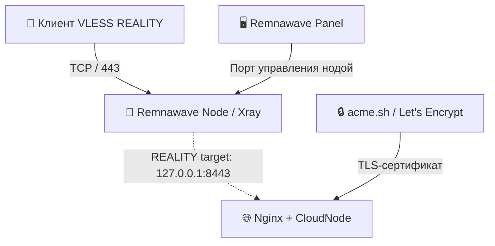

<div align="center">

# 🌐 Remnawave Node + SelfSNI

**Автоматическая установка Remnawave Node с локальным TLS-сайтом для REALITY Self-Steal SNI**

[](https://ubuntu.com/)
[](https://www.debian.org/)
[](https://www.docker.com/)
[](https://www.gnu.org/software/bash/)

**Один скрипт → Docker + Remnawave Node + Nginx + Let's Encrypt + оптимизация TCP**

[Быстрая установка](#-быстрая-установка) · [Настройка REALITY](#-настройка-reality) · [Диагностика](#-диагностика)

</div>

---

## ✨ Возможности

| Компонент | Что настраивается |
|:--|:--|
| 🐳 **Remnawave Node** | Установка Docker и Docker Compose; запуск ноды с `network_mode: host` |
| 🔐 **Let's Encrypt** | Выпуск ECC TLS-сертификата через `acme.sh` |
| 🌍 **SelfSNI** | Локальный HTTPS-сайт CloudNode в Nginx на `127.0.0.1:8443` |
| 🔄 **Автообновление** | Продление сертификата и перезагрузка конфигурации Nginx |
| 🚀 **TCP-тюнинг** | BBR при поддержке ядром, очереди соединений и лимиты открытых файлов |
| 🧾 **Логи и резервные копии** | Ротация Docker-логов и резервное копирование изменяемых файлов |

> [!NOTE]
> Настройки рассчитаны на типичную VPS с Ubuntu/Debian. Они могут повысить запас по соединениям, но не гарантируют отсутствия разрывов: результат зависит от нагрузки, сети и ресурсов сервера.

## 🧩 Как это работает



Nginx слушает **только локальный адрес** `127.0.0.1:8443`. Внешний порт `443` остаётся для Xray. Благодаря `network_mode: host` контейнер ноды обращается к локальному Nginx без отдельного Docker-маршрута.

## 📋 Требования

- Сервер **Ubuntu или Debian** с `systemd`, `apt` и правами `root`.
- Домен (например, `node.example.com`), чья **A-запись** указывает на IP сервера.
- Доступный извне **TCP/80** для выпуска и продления сертификата Let's Encrypt в standalone-режиме (без CDN-проксирования).
- **TCP/443** для VLESS REALITY; отдельный порт управления нодой должен быть доступен панели.
- `SECRET_KEY` из панели Remnawave.

> [!IMPORTANT]
> Если на сервере уже работают Nginx, Xray, Docker-сервисы или используется порт `80`/`8443`, проверьте конфликты до установки. Скрипт изменяет системные настройки и конфигурацию Nginx.

## ⚡ Быстрая установка

Подключитесь к серверу по SSH под `root` и выполните:

```bash
bash <(curl -fsSL https://raw.githubusercontent.com/radmir42/remna-selfsni/main/install.sh)
```

**Альтернатива (можно посмотреть код перед запуском):**

```bash
curl -fsSL https://raw.githubusercontent.com/radmir42/remna-selfsni/main/install.sh -o install.sh
less install.sh
sudo bash install.sh
```

Во время установки скрипт запросит:

1. **Домен SelfSNI** — например, `node.example.com`.
2. **Порт Remnawave Node** — по умолчанию `2222`.
3. **`SECRET_KEY`** — ключ подключения ноды из Remnawave Panel.

Email для `acme.sh` уже задан в установщике и **не запрашивается**.

## ⚙️ Настройка REALITY

После установки откройте **Remnawave Panel → Config Profiles** и в соответствующем inbound с `security: reality` настройте поля **`streamSettings.realitySettings`**:

```json
{
  "streamSettings": {
    "security": "reality",
    "realitySettings": {
      "target": "127.0.0.1:8443",
      "xver": 0,
      "serverNames": ["node.example.com"]
    }
  }
}
```

Замените `node.example.com` на домен, указанный при установке. **Это фрагмент конфигурации, не полный inbound**: оставьте существующие `privateKey`, `shortIds`, порт, протокол и другие обязательные параметры REALITY. В настройках Host/SNI используйте тот же домен.

## 📁 Основные файлы

| Путь | Назначение |
|:--|:--|
| `/opt/remnanode/` | Конфигурация Docker Compose и ноды |
| `/etc/nginx/sites-available/remnawave-selfsteal.conf` | Конфигурация локального Nginx |
| `/etc/nginx/sites-enabled/remnawave-selfsteal.conf` | Активная ссылка на конфигурацию Nginx |
| `/var/www/html/index.nginx-debian.html` | Страница CloudNode |
| `/root/certs/fullchain.pem` | Цепочка TLS-сертификатов |
| `/root/certs/key.pem` | Приватный ключ TLS |
| `/etc/sysctl.d/99-remnanode-tuning.conf` | Параметры TCP и системные лимиты |

## 🩺 Диагностика

**Проверка Nginx и порта 8443:**

```bash
nginx -t
systemctl status nginx --no-pager
ss -lntp | grep -E ':443|:8443|:2222'
```

**Проверка Docker и ноды:**

```bash
docker ps
docker compose -f /opt/remnanode/docker-compose.yml ps
```

**Проверка сертификата:**

```bash
/root/.acme.sh/acme.sh --list
openssl x509 -in /root/certs/fullchain.pem -noout -dates -subject
```

> [!TIP]
> Если получение сертификата не проходит, сначала проверьте DNS, открытый TCP/80 и отсутствие другого процесса на этом порту: `ss -lntp '( sport = :80 )'`.

## 🔒 Безопасность

- Не публикуйте `SECRET_KEY`, приватный ключ REALITY и `/root/certs/key.pem`.
- Ограничьте доступ к порту управления нодой IP-адресом панели.
- Прежде чем выполнять удалённый shell-скрипт, просмотрите его содержимое и убедитесь, что доверяете репозиторию.
- Храните резервную копию рабочих конфигураций перед установкой на сервер с действующими сервисами.

---

<div align="center">

**Remnawave Node + SelfSNI** · [Исходный код](https://github.com/radmir42/remna-selfsni) · [Сообщить о проблеме](https://github.com/radmir42/remna-selfsni/issues)

<sub>Проект сообщества. Не является официальным установщиком Remnawave.</sub>

</div>
